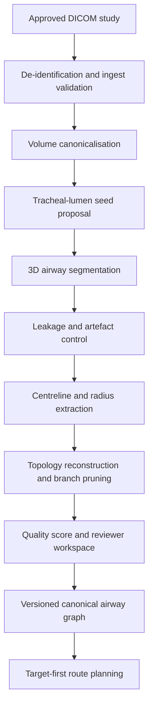
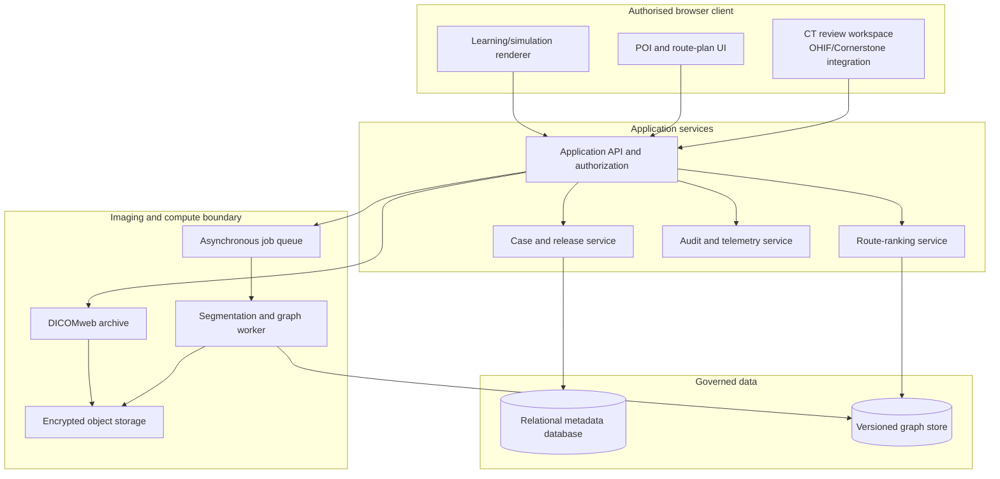
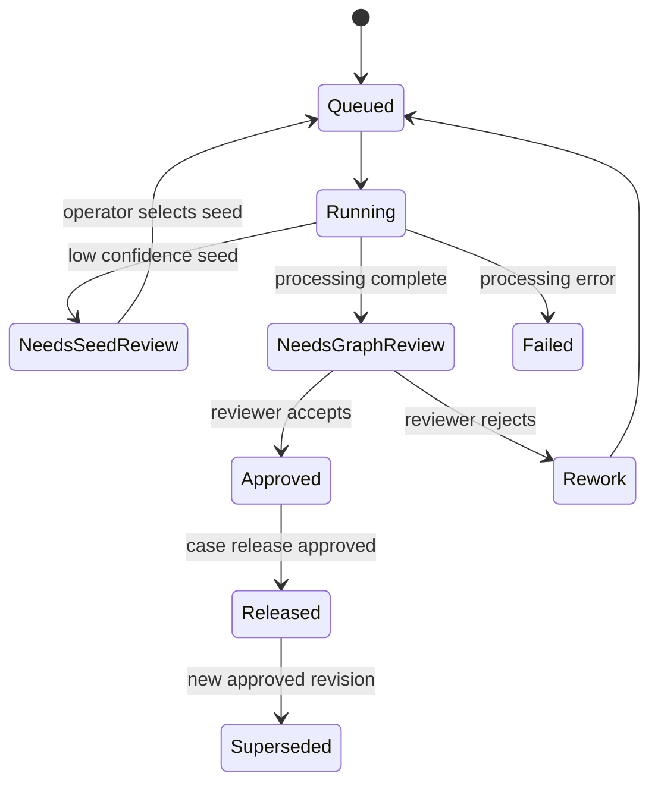

# Product Requirements Document: Lung Navigator
## Target-First CT Airway Exploration, Route Planning, and Learning Platform

| Document field | Value |
|---|---|
| **Document owner** | Product and technical leadership |
| **Version** | 1.0 |
| **Status** | Implementation-ready specification |
| **Primary scope** | Educational and simulation-research workflow |
| **Out of scope** | Diagnosis, treatment planning, autonomous procedural guidance, and clinical decision support |
| **Primary principle** | A selected point of interest must yield transparent, reviewable, and ranked airway routes from the tracheal root. |

---

## 1. Executive Decision Summary

**Lung Navigator** is a graph-first platform that converts a reviewed CT airway volume into two connected experiences. The first is a visual learning environment where users explore branching airway anatomy. The second is a **target-first planning workflow**: a user browses a CT volume, places a point of interest (POI), and receives a ranked set of airway routes that approach that destination. The ranked routes can then be visualised in the CT viewer, inspected in 3D, and used as targets in an anatomy-learning or simulation scenario.

The implementation must not interpret CT images in a browser-only static site. A credible workflow needs controlled DICOM ingestion, de-identification, asynchronous 3D image processing, graph construction, quality assurance, traceability, and permissions. The existing website is the **experience and interaction prototype**; it is not the production imaging application.

> **Purpose boundary:** The first production release is an educational and research platform. It must not present its path ranking as a diagnostic recommendation, a navigation instruction for a live procedure, or evidence of clinical competence.

The recommended technical strategy is to build a full-stack research application around a DICOMweb-compatible archive, a browser imaging viewer, a dedicated processing service, a versioned canonical airway graph, and an auditable case-release workflow. DICOMweb formally separates study query, object retrieval, and object storage through QIDO-RS, WADO-RS, and STOW-RS, respectively; Lung Navigator should preserve that separation in both technical design and access control.[1]

---

## 2. Product Vision, Scope, and Success Measures

### 2.1 Product vision

Lung Navigator makes the bronchial tree **navigable, interpretable, and measurable**. It creates a shared representation of airway anatomy that supports three distinct purposes without conflating them: public exploration, structured learning, and carefully governed simulation research.

| Product tier | Intended audience | Product promise | Evidence standard |
|---|---|---|---|
| **Explore** | Science-curious visitors and general learners | An atmospheric, approachable airway exploration experience | Usability, accessibility, engagement |
| **Learn** | Anatomy students and early trainees | Structured practice in branch recognition, route recall, and spatial orientation | Learning and retention measurement |
| **Validate** | Simulation researchers and clinical educators | A controlled environment for testing route-planning and navigation hypotheses | Expert review and pre-specified study protocol |

### 2.2 In-scope release capabilities

The first research-capable release must permit an authorised user to select a de-identified chest CT study, review the axial, coronal, sagittal, and 3D representations, place a POI in physical coordinates, inspect the airway mask and graph quality, receive ranked candidate routes, and launch a corresponding visualisation or learning scenario. Each result must identify its source case, source volume version, segmentation version, graph version, ranking algorithm version, and reviewer status.

### 2.3 Explicit non-goals

The product must not claim lesion detection, classify a target as a tumour, propose biopsy locations, assess procedural safety, prescribe a clinical route, or infer clinical competence from game performance. The platform may accept a user-labelled POI such as “target lesion” or “area for learning exercise,” but that label is user-supplied context and must not be transformed into a diagnostic conclusion.

### 2.4 North-star outcome and supporting measures

The north-star outcome for the learning product is **successful independent navigation to an anatomically defined target with retained route knowledge**. The north-star outcome for the planning product is **a reproducible, auditable, expert-reviewable route plan generated from a reviewed airway graph**.

| Dimension | Primary metric | Operational definition | Release interpretation |
|---|---|---|---|
| **Route-plan reliability** | Reviewed route-plan success rate | Percentage of quality-approved cases where an expert accepts at least one ranked candidate as anatomically plausible for the stated educational purpose | Primary planning gate |
| **Graph integrity** | Reviewed branch continuity | Proportion of sampled parent–child links judged topologically coherent by the QA protocol | Core processing gate |
| **Interaction usability** | POI-to-route completion rate | Users who select a POI, understand the ranking, and inspect a route without moderator assistance | Product usability gate |
| **Learning outcome** | Delayed route-recall accuracy | Correct target navigation after an appropriate delay and without guidance | Learning evidence |
| **Governance health** | Complete provenance coverage | Released cases whose required source, version, and review records are present | Hard release control |

---

## 3. Users, Jobs, and Permissions

### 3.1 Primary users

| User | Primary job | Product need | Access level |
|---|---|---|---|
| **Learner** | Understand how airway branches relate and reach a target | Clear landmarks, safe practice, feedback, and progress context | Released educational cases only |
| **Clinical educator** | Assemble or assign anatomy-learning exercises | Reviewed route plans, labels, difficulty controls, and learner summaries | Educational case authoring and review |
| **Imaging/research operator** | Prepare a CT-derived case | Study inspection, segmentation status, graph QC, POI workflows, and release controls | Controlled case-processing workspace |
| **Clinical reviewer** | Assess educational anatomical validity | Synchronized CT, airway mask, graph, routes, reviewer comments, and release decision | Review and approval workspace |
| **Study administrator** | Govern research use | Participant access, consent state, audit export, retention and case permissions | Administration and audit only |

### 3.2 Role model

The platform must use role-based access control and must additionally restrict access by case release state. A learner may see a released teaching case but must not access raw DICOM objects, quality-control notes, hidden algorithmic candidates, or any record linking the case to a person or source institution. A reviewer may inspect pre-release imagery and algorithm output but may not modify the immutable processing provenance.

| Role | Can read raw DICOM | Can set POI | Can run processing | Can edit graph labels | Can approve case | Can access learner analytics |
|---|---:|---:|---:|---:|---:|---:|
| Learner | No | Only scenario POIs | No | No | No | Own summary only |
| Educator | No by default | Yes, in released derivative case | No | Limited annotation | No | Assigned cohort only |
| Research operator | Controlled | Yes | Yes | Proposed edits only | No | De-identified study data |
| Clinical reviewer | Controlled | Yes | Re-run approved jobs only | Approve/reject labels | Yes | De-identified study data |
| Administrator | Configuration only | No | No | No | No | Governed audit access |

---

## 4. Core Target-First Workflow

### 4.1 Product principle

The initial user action is **not** to start a virtual journey. It is to locate a meaningful point in the volume. The platform then explains how that point relates to the airway tree before rendering a path. This creates a transparent chain of reasoning:

```mermaid
flowchart LR
  A[Select approved CT study] --> B[Review multiplanar volume]
  B --> C[Place point of interest in physical coordinates]
  C --> D[Load approved airway graph]
  D --> E[Find closest eligible airway candidates]
  E --> F[Compute constrained paths from tracheal root]
  F --> G[Rank and explain alternatives]
  G --> H[Reviewer approval or learning scenario launch]
```



### 4.2 Detailed workflow states

| State | User action | System behaviour | Required output | Failure or warning state |
|---|---|---|---|---|
| **Study selection** | Select an authorised, de-identified study | Fetch metadata and released derivative availability | Study summary and data-use state | Block if no approved derivative or permission |
| **Volume review** | Navigate axial, coronal, sagittal, and optional 3D view | Stream only permitted image data; preserve orientation and measurement context | Synchronized viewports | Display “image quality not approved” if blocked |
| **POI placement** | Click, crosshair-adjust, or enter coordinates | Transform viewport location to patient/volume physical coordinates | Immutable POI record in millimetres | Require confirmation if target is outside valid volume bounds |
| **Graph readiness** | Request route planning | Verify graph version, QA state, and spatial registration | Graph summary and confidence state | Block if no QA-approved graph exists |
| **Candidate search** | Confirm target | Find nearest eligible centreline samples and/or terminal branches | Candidate list with distance and confidence | Explain if no candidate satisfies policy threshold |
| **Route calculation** | Inspect output | Compute root-to-candidate graph paths using explicit score weights | Ranked route list and reasons | Flag disconnected graph or invalid root |
| **Route review** | Select a candidate | Render CT overlays, branch list, 3D fly-through, and provenance | Selected route-plan revision | Require clinical reviewer before educational release when case policy requires it |
| **Scenario launch** | Start learning activity | Convert approved route to an exercise objective with declared fidelity | Scenario configuration and telemetry session | Do not expose non-released graph artefacts |

### 4.3 POI placement requirements

The POI must be stored in **physical patient/volume coordinates in millimetres**, not merely as a pixel coordinate in the active slice. The record must retain its source study, series, frame of reference, image orientation, slice/volume reference, and the viewport state used at placement. This enables the platform to reproduce the point in any compatible multiplanar view.

The user interface must show a reticle, a small coordinate readout, the point label, and an explicit note that the selected point is user-defined. It must support at least three point categories: **educational target**, **user-marked area of interest**, and **research annotation**. Any more specific clinical label must be provisioned only by the governed research protocol.

| Requirement ID | Requirement | Priority | Acceptance criterion |
|---|---|---:|---|
| **POI-01** | Enable a user to place, drag, label, and remove a POI in a synchronized multiplanar view. | Must | The same POI renders within ±1 voxel or defined spatial tolerance across axial, coronal, and sagittal views. |
| **POI-02** | Persist physical coordinate, source volume version, creator, timestamp, and intended purpose. | Must | Every saved POI has complete provenance fields. |
| **POI-03** | Permit an authorised reviewer to lock a POI for a released educational case. | Must | Locked POIs cannot be altered by learner-role accounts. |
| **POI-04** | Display a target-to-airway proximity summary before route ranking. | Must | The user sees units, selected candidate count, and eligibility state. |

---

## 5. CT Review and DICOM Integration

### 5.1 Recommended transport pattern

The imaging layer should use standard web imaging interfaces rather than direct browser access to a filesystem or ad hoc upload endpoints. DICOMweb defines QIDO-RS for query, WADO-RS for retrieval, and STOW-RS for object storage.[1] The product must map its permissions and logs onto those actions independently.

| DICOMweb capability | Lung Navigator use | Product rule |
|---|---|---|
| **QIDO-RS** | Query authorised studies, series, and metadata | Return only minimum metadata required for the user role and task. |
| **WADO-RS** | Retrieve permitted image frames, derived masks, and structured objects | Use signed/authorised requests; never expose unrestricted archive credentials to the browser. |
| **STOW-RS** | Store permitted DICOM derivatives if selected for interoperability | Restrict to authorised service accounts and retain immutable audit records. |

### 5.2 Viewer recommendation

Use an imaging-specific browser viewer rather than recreating radiology primitives from scratch. OHIF supports DICOMweb data-source configuration, while Cornerstone3D supports streamed volume viewing, multiplanar reconstruction, and labelmap segmentation rendering.[2] [3] The product should integrate or extend these components for review, but it should own the business workflow around permissioning, case release, POI governance, graph processing, and route review.

| Viewer capability | Required implementation | Acceptance criterion |
|---|---|---|
| **Multiplanar review** | Axial, coronal, sagittal, and optional 3D layout with linked crosshair | Crosshair and POI location synchronize across views. |
| **Window/level and presets** | Provide configurable CT airway/lung and mediastinal display presets | User can inspect a selected POI in each preset without changing physical location. |
| **Segment overlay** | Overlay approved airway segmentation with adjustable opacity and outline | User can distinguish raw CT, mask, and graph without ambiguity. |
| **Graph overlay** | Render centreline and branch ID/label overlays with visibility controls | Selecting a route highlights only the relevant path and its candidates. |
| **Derived object state** | Clearly label images, masks, and graphs as source or derivative | Every visible derivative shows version and approval state. |

### 5.3 Important implementation correction: “colour” and scan direction

CT does not supply a universal “air colour.” It is a grayscale modality whose pixels encode attenuation values; display colours are viewer choices. The production algorithm must therefore use calibrated voxel values, image metadata, and 3D context—not the user-visible colour in a screenshot—to identify air-filled lumen.

Similarly, the system must not hard-code “start at the top slice.” Different studies can be stored in different instance orders or orientations. The pipeline must derive the anatomic direction from DICOM orientation and position metadata, identify the tracheal region within the physical volume, and record the selected seed. The system may search in a configurable superior central thoracic region as a candidate-detection heuristic, but the final seed must be validated by 3D connectivity and quality checks.

---

## 6. Airway Segmentation and Canonical Graph Construction

### 6.1 Engineering decision

The production pipeline must use **volumetric, topology-aware segmentation**. A slice-by-slice Hough-circle method may be retained as an educational visualisation or research baseline, but it is not an acceptable principal implementation because airway branches are oblique, irregular, partially volumed, and variable in radius. Airway segmentation and centreline extraction are linked problems in the technical literature and should be implemented as a single governed pipeline.[4]

### 6.2 Processing stages



### 6.3 Detailed pipeline specification

| Stage | Processing requirement | Output | Required quality control |
|---|---|---|---|
| **Ingest** | Validate modality, image consistency, orientation, spacing, and de-identification state. | Immutable source manifest | Reject unsupported or incomplete series. |
| **Canonicalisation** | Convert images to a physical-coordinate volume while retaining original DICOM references. | Canonical volume and transform metadata | Verify spacing/orientation transformation. |
| **Tracheal seed proposal** | Identify candidate air lumen in central upper thorax using attenuation, size, location, and continuity features. | Ranked seed candidates | Require automated confidence and operator confirmation for low-confidence seeds. |
| **Lumen segmentation** | Use a 3D algorithm, preferably with multi-threshold, region-growing, morphological, and/or model-based components. | Airway mask and confidence volume | Detect leakage into lung parenchyma and disconnected fragments. |
| **Topology recovery** | Skeletonise or extract centreline, estimate local radius, identify nodes and edges, and remove noise branches. | Directed airway graph | Preserve branch-to-voxel references. |
| **Semantic enrichment** | Add optional lobe/segment labels, landmarks, and reviewer annotations. | Labelled graph | Distinguish algorithmic label from reviewer-approved label. |
| **Case release** | Bind graph, QA result, and allowed purpose into one immutable release revision. | Released case package | Block learner use of unapproved revisions. |

### 6.4 Tracheal-lumen seed strategy

The seed-finding service must use a **candidate-and-validate** strategy rather than assume the first air-filled region is the trachea. The candidate score should combine centrality, superior–inferior position in physical space, connected-component volume, expected lumen shape, proximity to the airway axis, and continuity across neighbouring slices. The exact model may evolve, but it must emit a confidence score and a visual candidate overlay.

The initial release should provide an operator control to choose among top seed candidates when automated confidence is below the approved threshold. The selected seed becomes a signed input to the processing run and must be visible in the quality-control workspace.

### 6.5 Graph model

The canonical graph is the system of record for navigation and learning. It must be separate from any renderer, game scene, or 3D mesh.

```json
{
  "graph_version_id": "agv_01JXYZ",
  "case_revision_id": "case_004_r03",
  "coordinate_system": "patient_physical_mm",
  "root_node_id": "node_trachea",
  "nodes": [
    {
      "id": "node_carina",
      "position_mm": [12.4, -83.1, 41.7],
      "radius_mm": 8.2,
      "kind": "bifurcation",
      "confidence": 0.96,
      "qa_status": "reviewed"
    }
  ],
  "edges": [
    {
      "id": "edge_r_main",
      "from_node_id": "node_carina",
      "to_node_id": "node_r_main_distal",
      "centreline_mm": [[12.4, -83.1, 41.7], [13.1, -88.9, 36.2]],
      "radius_samples_mm": [8.2, 7.6, 7.1],
      "length_mm": 9.7,
      "branch_order": 1,
      "semantic_label": "right main bronchus",
      "confidence": 0.95,
      "qa_status": "reviewed"
    }
  ]
}
```

### 6.6 Graph-quality policy

Every graph must carry a **case quality profile** rather than a single opaque accuracy score. The profile must separately report source-image adequacy, seed confidence, segmentation confidence, leakage flags, branch connectivity, graph completeness, label completeness, reviewer state, and permitted use. This supports the key product rule: a visually interesting case may be eligible for public exploration, while a low-confidence graph must be blocked from assessed learning or research use.

### 6.7 Anatomical provenance rules

The source CT is the anatomical authority. Segmentation masks, graphs, routes and endoluminal views are derivatives and must never present more anatomy than the CT demonstrates.[7]

| Rule | Requirement |
|---|---|
| **No invented airway** | The pipeline must not extend, synthesise or probabilistically complete distal airways. Upsampling or resampling a volume does not recover anatomy and must not be presented as doing so. |
| **No silent bridging** | Disconnected fragments are dropped or flagged, never joined without record. Any bridge between components is an *interpolated* object, not airway. |
| **Separate provenance classes** | Every graph edge and mask region carries `provenance`: `ct` (segmented from the source CT), `manual` (reviewer correction supported by the CT) or `interpolated` (bridge not demonstrated on CT). Interpolated objects are stored separately, rendered in a visibly different style, record their endpoints and dimensions, and are listed in the audit trail. |
| **Geometry is not edited for convenience** | Diameter, branch orientation, bifurcation position and branch length must not be altered to make a route connect or look smoother. |
| **Display smoothing is display-only** | Smoothed surfaces or curves produced for presentation are tagged display-only and are never used for centreline extraction, route construction or QA measurement. |
| **Route-level topology** | A single route curve does not establish sibling-branch anatomy. Branch-choice information (for example clock positions at a fork) must be derived from the segmented bifurcation topology in the graph, not inferred from the route alone. |

Interpolated content may be used for an explicitly requested experimental route, but such a route inherits the `interpolated` flag and is ineligible for learner release under §7.2.

---

## 7. Target-to-Airway Candidate Search and Route Ranking

### 7.1 Candidate selection problem

The POI can reside inside an airway, adjacent to an airway, or outside the airway tree. The product must therefore distinguish the user’s selected destination from the graph node used as the route endpoint. The planning service should evaluate the nearest valid graph samples, branch termini, and eligible branch segments—not simply snap to the globally nearest vertex without context.

For a target point \(t\) and a graph edge \(e\) represented by centreline samples, define a proximity function:

\[
d(t,e) = \min_{p \in e} \lVert t - p \rVert_2
\]

The service finds candidate endpoint records \(C = \{c_1, c_2, ... c_k\}\) among graph samples/edges that satisfy all release and quality constraints. Each candidate retains the nearest point, distance in millimetres, branch confidence, and a reason for eligibility or rejection.

When the POI lies beyond the last CT-demonstrated airway, the route terminates at the most distal reliable airway sample. The remaining straight-line distance from that endpoint to the POI is stored as `target_gap_mm` and shown as uncertainty in every route view. The system must not draw or describe an airway across that gap (§6.7).

### 7.2 Eligibility policy

| Criterion | Purpose | Initial policy |
|---|---|---|
| **Case release state** | Prevent planning against non-approved derivative graphs | Candidate must come from an approved graph revision. |
| **Graph continuity** | Prevent paths through broken components | Candidate must be reachable from the tracheal root. |
| **Segmentation confidence** | Avoid low-confidence geometry | Candidate branch confidence must meet configured use-tier threshold. |
| **Target proximity** | Avoid implausibly remote branch matches | Candidate must be within configured research/education threshold or be explicitly marked “distant.” |
| **Minimum radius** | Avoid routes unsuitable for selected learning fidelity | Apply a configurable scenario constraint; do not represent as clinical suitability. |
| **Reviewer exclusions** | Honour known artefacts or anatomically unsuitable regions | Excluded branches never appear in learner release. |

### 7.3 Route construction

For each eligible candidate, calculate the unique root-to-candidate path in the rooted airway tree. In the rare event of a graph that contains cycles due to processing artefact, the system must either repair the graph before release or apply a cycle-safe shortest-path algorithm and flag the graph for review. A tree structure is the expected canonical form.

The initial ranking score should be transparent and configurable:

\[
\text{score}(c) = w_d\,\hat d(t,c) + w_l\,\hat L(root,c) + w_b\,B(root,c) + w_q\,(1-Q(c)) + w_a\,A(c)
\]

where \(\hat d\) is normalised target proximity, \(\hat L\) is normalised route length, \(B\) is branch complexity, \(Q\) is quality confidence, and \(A\) is an optional educational constraint penalty. The product must store the exact weights, values, and algorithm version that produced each result.

> **Interpretation requirement:** A lower score means “more suitable under the declared educational/research policy.” It must never be labelled “best clinical route” or imply procedural safety.

### 7.4 Explainable ranking output

The ranked route panel must provide more than a numbered list. It must answer: *Which branch is closest? How close is it? How many bifurcations are involved? Why was it ranked before alternatives? Is the graph reviewed?* 

| Output field | Example | Purpose |
|---|---|---|
| **Rank** | 1 of 3 | Establishes ordered candidate list |
| **Path** | Trachea → right main → right lower lobe lateral basal | Shows the branch sequence |
| **POI proximity** | 11.8 mm from nearest centreline point | Separates target from route endpoint |
| **Graph path length** | 142.6 mm | Supports comparison without clinical overclaim |
| **Branch count** | 5 decision points | Supports learning difficulty design |
| **Confidence state** | Reviewed graph · 0.94 algorithm confidence | Shows evidence and review level |
| **Ranking rationale** | Closest eligible branch with lowest configured route score | Supports human interpretation |
| **Restrictions** | Educational use only | Makes governing purpose visible |

### 7.5 Route-plan data contract

```json
{
  "route_plan_id": "rp_01JXYZ",
  "case_revision_id": "case_004_r03",
  "graph_version_id": "agv_01JXYZ",
  "poi_id": "poi_01JXYZ",
  "algorithm": {
    "name": "rooted-airway-route-ranker",
    "version": "0.1.0",
    "weights": { "proximity": 0.45, "length": 0.20, "branchComplexity": 0.10, "quality": 0.20, "scenarioPenalty": 0.05 }
  },
  "candidates": [
    {
      "rank": 1,
      "endpoint_edge_id": "edge_rll_lateral_basal",
      "nearest_point_mm": [22.1, -104.6, 9.7],
      "poi_distance_mm": 11.8,
      "path_edge_ids": ["edge_trachea", "edge_r_main", "edge_bronchus_intermedius", "edge_rll_lateral_basal"],
      "graph_path_length_mm": 142.6,
      "bifurcation_count": 4,
      "score": 0.214,
      "confidence": 0.94,
      "qa_status": "reviewed",
      "explanation": ["closest eligible endpoint", "continuous root path", "meets scenario radius constraint"]
    }
  ]
}
```

---

## 8. Learning and Simulation Experience

### 8.1 Fidelity tiers

The product must not use a single renderer for all purposes. The airway graph is shared, but visual fidelity is purpose-specific.

| Tier | Representation | Use | Product limitation |
|---|---|---|---|
| **Stylised Explore** | 2D/2.5D SDF or procedural branch world | Engagement and early orientation | Does not preserve complete 3D anatomy. |
| **Anatomy Learn** | Native 3D graph, CT-derived surfaces or volume view | Segment recognition and route knowledge | Does not independently establish procedural skill. |
| **Research Simulation** | Reviewed CT-derived graph, scenario controls, reproducible telemetry | Controlled learning and simulation studies | Requires protocol-specific validation. |

### 8.2 Learning modes

| Mode | Route relationship | Instructional purpose | Required telemetry |
|---|---|---|---|
| **Guided orientation** | Primary route visible | Encode landmarks and branch hierarchy | Assistance use, landmark recognition |
| **Target recall** | Primary route hidden | Retrieve a familiar path | Wrong turns, time, route efficiency |
| **Reverse navigation** | Start at target, end at trachea | Test flexible route knowledge | Reverse-route accuracy |
| **Randomised reroute** | New start–target pair | Reduce pure sequence memorisation | Success from unseen start point |
| **Path comparison** | Primary and alternate routes visible after attempt | Explain branching and error recovery | Decision-point reflection completion |

Spatial-navigation research supports the distinction between flexible map-like knowledge and familiar route sequences; Lung Navigator should design for both while treating clinical transfer as a hypothesis to test.[5] Simulation training literature further supports structured practice and assessment rather than relying on a single internal score.[6]

### 8.3 Endoluminal orientation aids

The first-person (virtual bronchoscopy) view is a CT-derived pre-procedural representation. It must not be described as real-time localisation or as registration of a bronchoscope to the patient.

- **Camera frame.** The camera follows the route centreline with a minimal-twist (parallel-transported) frame initialised with patient anterior as "up", so airway curvature alone never rotates the image.
- **Simulated steering.** Approaching a fork, the camera rolls so the chosen daughter branch reaches 12 o'clock, pauses shortly before the fork, then advances (roll → deflect → advance). Roll is locked between forks. The roll is labelled *simulated steering*: CT cannot determine shaft torsion, operator hand rotation, scope looping or real camera orientation.
- **Clock convention.** Clock positions are measured in the transported frame at each fork: 12 = frame up (anterior at the trachea), 3 = right, 6 = down, 9 = left. The dial itself never rotates.
- **Anterior indicator.** An arrow shows patient anterior projected into the image plane. When the view runs nearly along the anterior–posterior axis the arrow is hidden and the view states that anterior is undefined.
- **Engineering parameters.** Roll onset (≈10 mm before a fork), pause distance (≈5 mm) and look-ahead are engineering parameters, not validated clinical values, and must not be presented as such.
- **Single camera model.** Recorded playback and video export use the same camera function as interactive navigation.
- **Visible limitations.** The view must keep visible: CT-to-body divergence, inspiratory CT versus procedural lung volume, respiratory motion, atelectasis, patient positioning and incomplete distal segmentation.

### 8.4 Telemetry requirements

Telemetry must be purpose-limited. The platform should record events needed to improve product usability and evaluate the learning protocol, such as session start/end, target assignment, decision-point choices, assistance requests, route completion, and reflection response. It must not silently record raw patient DICOM data, clinician identity in learner events, or unneeded browser/device identifiers.

---

## 9. Reference Architecture and Deployment Choices

### 9.1 Implementation options

The project has two viable routes. The lighter option supports product discovery and safe UX iteration; the recommended option supports approved imaging cases and reproducible research. The team should decide based on whether real CT-derived cases are required.

| Approach | Trade-offs | Cost | Setup complexity |
|---|---|---|---|
| **Interactive prototype with synthetic or pre-approved derivative data** | Fastest way to validate interface, route explanation, and learning loop. It cannot accept real DICOM studies or produce new airway graphs. | Lowest | Low |
| **Full research platform with controlled imaging pipeline** **(recommended for CT-derived cases)** | Supports governed DICOM review, processing, graph versioning, and route-plan auditability. Requires backend services, access control, queue processing, QA operations, and governance. | Higher infrastructure and operating cost | High |

### 9.2 Recommended logical architecture



### 9.3 Service responsibilities

| Component | Responsibility | Must not own |
|---|---|---|
| **Browser client** | Imaging interaction, POI placement, route inspection, learning UX | De-identification, raw segmentation compute, long-lived credentials |
| **Application API** | Authentication, authorization, orchestration, business rules, case state transitions | Pixel-level image-processing algorithms |
| **DICOMweb archive** | Governed query, retrieval, and controlled storage of DICOM objects | Learning analytics or route scoring policy |
| **Processing worker** | Canonicalisation, segmentation, graph extraction, mesh/derivative generation | Human release decision |
| **Graph service** | Graph version storage, spatial candidate search, route ranking | Source DICOM identity resolution |
| **Case/release service** | Quality state, reviewer decision, release tier, provenance | Render implementation details |
| **Audit service** | Append-only security and workflow events | Mutable case anatomy records |

### 9.4 Compute and hosting insight

The public-facing experience can remain a managed web application. However, high-resolution DICOM normalisation, image-processing libraries, long-running segmentation, and job queues should be treated as backend compute workloads rather than browser work. A managed full-stack application is appropriate for interactive review, metadata, and short jobs within its resource limits; a separate controlled compute environment is appropriate when image-processing dependencies, containerisation, or resource requirements exceed those limits. The runtime choice must be made from the actual workload profile, not from a preferred language or framework.

### 9.5 Suggested technology boundaries

| Concern | Suggested implementation direction | Rationale |
|---|---|---|
| **Viewer** | OHIF/Cornerstone3D integration or custom viewer built on Cornerstone3D | Avoid reimplementing medical-image orientation, MPR, and segmentation overlay primitives. |
| **Archive** | DICOMweb-compatible archive | Retain standard query/retrieve/store boundaries. |
| **Processing** | Python or native-image-processing worker with explicit versioned container/environment | Mature ecosystem for volumetric image operations and reproducibility. |
| **API and workflow** | Typed backend API with role checks and task state machine | Clear domain contracts and auditable transitions. |
| **Metadata** | Relational database | Strong fit for case state, permissions, versions, reviews, and audit joins. |
| **Graph index** | Persisted graph plus spatial index | Efficient nearest-centreline and root-path queries. |
| **Object storage** | Encrypted immutable-ish storage for derived artefacts | Preserve reproducible source-to-derivative chain. |

---

## 10. API and Domain Specifications

### 10.1 Core entities

| Entity | Purpose | Immutable fields | Mutable fields |
|---|---|---|---|
| **Study manifest** | Records authorised source-study context | Source references, ingest checksum, de-ID state | Operational retention state |
| **Case revision** | Defines a purpose-bound derivative case | Source graph/version links, release provenance | Draft metadata before release |
| **Processing run** | Records one processing execution | Input revision, code version, config, timestamps | Terminal status and review annotations |
| **Airway graph version** | Canonical structural model | Nodes, edges, geometry, transform, algorithm version | Never mutate; supersede with new version |
| **POI** | User-selected target | Coordinate, source revision, creator, timestamp | Label/purpose until locked |
| **Route plan** | Ranked candidate path result | Input POI, graph version, algorithm/weights | Review status and approved candidate |
| **Scenario** | Learning exercise definition | Case, route plan, task rules | Copy/visual settings until published |
| **Review decision** | Human approval or rejection | Reviewer, decision, decision time | Addendum only; never overwrite decision |

### 10.2 Illustrative API surface

| Endpoint | Method | Purpose | Authorization |
|---|---|---|---|
| `/studies` | `GET` | Query permitted study metadata | Operator/reviewer |
| `/studies/{id}/viewer-session` | `POST` | Issue scoped viewer session/configuration | Role and case-policy checked |
| `/cases/{id}/processing-runs` | `POST` | Request governed processing run | Operator only |
| `/processing-runs/{id}` | `GET` | Read job status, quality artefacts, and errors | Operator/reviewer |
| `/case-revisions/{id}/pois` | `POST` | Create a provenance-bound POI | Operator/reviewer/educator by policy |
| `/case-revisions/{id}/route-plans` | `POST` | Generate ranked candidates from a POI | Role and graph QA checked |
| `/route-plans/{id}` | `GET` | Retrieve candidates, explanation, versions, and selected route | Policy-controlled |
| `/case-revisions/{id}/reviews` | `POST` | Add approval, rejection, or required correction | Reviewer only |
| `/scenarios/{id}/launch` | `POST` | Issue learner session for released content | Learner or educator |

### 10.3 Processing job state machine



---

## 11. Quality Assurance, Validation, and Acceptance Criteria

### 11.1 Processing QA

The platform must treat quality assurance as a functional product capability, not a project-management step. The reviewer workspace must support synchronized inspection of source CT, airway mask, centreline, graph nodes/edges, route overlays, and errors/flags. Reviewers must be able to approve, reject, or request rework with a structured reason code.

| QA domain | Required check | Pass condition |
|---|---|---|
| **Input volume** | Correct series and physical geometry | No blocking orientation, spacing, or completeness issue |
| **Seed** | Tracheal-lumen seed plausibility | Seed lies in review-accepted airway lumen region |
| **Mask** | Leakage, discontinuity, and artefact inspection | No unreviewed major leakage; exceptions documented |
| **Graph** | Root connectivity, centreline placement, branch pruning | Selected routes trace continuously from tracheal root |
| **POI** | Location and purpose validity | Coordinate/label confirmed by authorised role |
| **Ranking** | Candidate eligibility and score explanation | Each candidate is reproducible from stored inputs and weights |
| **Release** | Case purpose and access tier | Required approvals and provenance complete |

### 11.2 Product acceptance criteria

| Requirement group | Acceptance criterion |
|---|---|
| **Viewer** | An authorised user can load an approved case in synchronized multiplanar views and identify source vs derivative objects. |
| **POI** | A POI placed in one viewport reproduces in all linked viewports, remains attached to the correct case revision, and logs its purpose. |
| **Processing** | A processing run creates immutable logs, produces required derivative artefacts, and exposes clear terminal failure states. |
| **Graph** | The graph contains a declared root, consistent physical units, directed edges, local radius information, and QA metadata. |
| **Ranking** | A route plan returns the configured number of eligible candidates, each with distance, path, score, algorithm version, and explanation. |
| **Review** | A reviewer can reject a graph or route plan with structured feedback; rejected content cannot be released. |
| **Learning** | A released route plan can be transformed into a learner scenario without exposing restricted data. |
| **Audit** | Every route plan can be traced to its input POI, graph, processing run, case revision, and user actions. |

### 11.3 Learning and research validation

The system must distinguish *software verification* from *educational or research validation*. Software verification confirms that a POI renders correctly and that a route score is reproducible. Educational validation asks whether the structured learning experience improves targeted learning outcomes. Clinical transfer, if studied, must use an independently governed protocol and an appropriate external assessment—not in-app performance alone.

| Gate | Question | Evidence required before progression |
|---|---|---|
| **G1: Usable** | Can intended users understand POI placement and route explanation? | Formative testing, observed task completion, issue log |
| **G2: Technically reliable** | Do graph and route outputs reproduce from controlled inputs? | Automated regression suite, QA review sample, provenance audit |
| **G3: Educationally credible** | Can learners use the system to acquire and recall anatomy/route knowledge? | Pre-defined learning study and retention measurement |
| **G4: Simulation credible** | Do experts judge scenario cues and outcomes fit for the stated simulation purpose? | Structured expert review and content-validity evidence |
| **G5: Transfer hypothesis** | Does performance relate to an independently defined external simulation outcome? | Protocol-driven research study; no automatic clinical claim |

---

## 12. Security, Privacy, and Governance Requirements

### 12.1 Non-negotiable controls

The platform must operate under the data-use, privacy, security, and ethics requirements applicable to the deployment context. The PRD does not substitute for institutional policy, legal review, or research governance. Product implementation must therefore expose the controls those functions require rather than assume that de-identification alone resolves every obligation.

| Control | Requirement |
|---|---|
| **De-identification** | Perform and document de-identification before any imaging case is exposed to a learner or public-facing experience. |
| **Least privilege** | Use role- and case-policy access checks for study query, retrieval, processing, review, and scenario launch. |
| **Scoped credentials** | Browser receives only short-lived, purpose-limited access—not archive-wide credentials. |
| **Encryption** | Protect data in transit and at rest according to deployment policy. |
| **Auditability** | Log access to source/derivative case data, POI creation, processing runs, route plans, reviews, releases, and exports. |
| **Retention** | Define source, derivative, audit, and telemetry retention schedules before production use. |
| **Data minimisation** | Store only information needed for the approved learning or research purpose. |
| **Export controls** | Restrict raw DICOM and derived graph exports; log authorised releases. |

### 12.2 Governance UX

Governance must be visible in the user interface. Every case should expose a clear purpose badge, release status, graph/review state, and any use restriction. The route panel must state whether the output is a **learning route**, **research planning artefact**, or **unreleased draft**. These labels prevent a polished interface from implying an unsupported level of clinical certainty.

---

## 13. Non-Functional Requirements

| Area | Requirement |
|---|---|
| **Reproducibility** | The same approved volume, seed, processing configuration, graph version, POI, and ranking weights must yield the same route-plan result. |
| **Performance** | Viewer should progressively stream the volume and keep POI interaction responsive; processing should run asynchronously with user-visible status rather than block the browser. |
| **Availability** | A processing failure must not corrupt a released case or route plan. |
| **Accessibility** | Provide keyboard-accessible controls, readable contrast, reduced-motion support, non-colour-only status cues, and a non-first-person alternative for motion-sensitive learners. |
| **Observability** | Capture structured application metrics, processing logs, error traces, and audit events with correlation IDs. |
| **Versioning** | Never mutate a released graph or route plan in place. Supersede with a new version and preserve lineage. |
| **Internationalisation readiness** | Separate labels and scenario copy from anatomy/graph IDs so educational content can be localised later. |
| **Testability** | Provide deterministic fixtures: small synthetic CT volume, expected mask, expected graph, POI set, and expected ranked route output. |

---

## 14. Delivery Roadmap

### Phase 0 — Product and governance foundation

Define the allowed data sources, user roles, case-purpose taxonomy, research/education boundary, and approval workflow. Produce a synthetic fixture dataset and a prototype user-test script. **Exit criterion:** Product, privacy, and review stakeholders agree on purpose, case states, and initial success measures.

### Phase 1 — Interaction prototype

Extend the existing website into a high-fidelity interaction prototype using non-identifying fixture data. Validate POI placement, route explanations, terminology, hierarchy, and the relationship between CT context and learning scenario. **Exit criterion:** Users can complete the POI-to-route workflow and understand the difference between primary and alternate candidates.

### Phase 2 — Controlled imaging workspace

Introduce authenticated case metadata, approved study selection, a DICOMweb-connected viewer, and scoped imaging sessions. Do not yet expose raw imaging outside the authorised operator/reviewer workspace. **Exit criterion:** An authorised user can review an approved fixture study in synchronized multiplanar views and create a fully provenance-bound POI.

### Phase 3 — Segmentation and graph MVP

Implement the asynchronous processing pipeline for canonicalisation, seed selection, volumetric airway segmentation, graph extraction, quality profile generation, and reviewer workspace. **Exit criterion:** The system generates a versioned graph from a fixture dataset, exposes review artefacts, and blocks release on QA failure.

### Phase 4 — Route-plan MVP

Implement candidate search, root-to-target path construction, transparent scoring, route-plan review, and regression tests. **Exit criterion:** A saved POI yields deterministic ranked candidates with complete explanations and provenance.

### Phase 5 — Learning integration

Convert approved route plans into guided, recall, reverse, and randomised scenarios. Add learner-facing safeguards that separate stylised experiences from CT-derived anatomy. **Exit criterion:** An approved plan can create a learner scenario with role-appropriate data exposure and consent-aware telemetry.

### Phase 6 — Validation and scale-out

Run formal usability, processing QA, educational, and simulation-research validation gates. Expand case catalogue only after release controls and operational monitoring are stable. **Exit criterion:** Stakeholders approve the evidence needed for the next use tier.

---

## 15. Key Risks and Design Responses

| Risk | Why it matters | Design response |
|---|---|---|
| **Slice-only detection fails** | Branches are not reliably represented as circles in individual slices. | Use volumetric segmentation and topology-aware graph extraction. |
| **Seed identifies wrong air space** | A wrong seed can propagate an incorrect graph. | Use candidate scoring, 3D validation, confidence threshold, and operator review. |
| **POI appears precise but is poorly contextualised** | A point may be far from an eligible airway or reflect uncertain anatomy. | Show physical distance, candidate confidence, and explicit “no eligible path” state. |
| **Route score is mistaken for clinical advice** | The interface can overstate algorithmic authority. | Use purpose badges, explainable scoring, and non-diagnostic language everywhere. |
| **Derivative/version drift** | A route may no longer correspond to its source graph or case. | Immutable versions, lineage links, and no in-place mutation of released records. |
| **Heavy processing degrades interactive UX** | Volumetric work can block the UI or fail unpredictably. | Isolate processing in asynchronous jobs with status, retry, and error states. |
| **Insufficient data governance** | Medical imaging creates sensitive-data and institutional obligations. | Enforce de-ID, scoped access, audit, retention, and reviewer release gates. |
| **Gamified metrics are overinterpreted** | In-app scores may not represent procedural performance. | Treat learning/transfer as separate, staged validation questions. |

---

## 16. Open Decisions Required Before Build

| Decision | Why it changes implementation | Owner | Recommended initial choice |
|---|---|---|---|
| **Data source** | Determines archive, de-ID, and access architecture | Product + governance | Use synthetic fixtures until a governed research dataset is approved. |
| **Case purpose taxonomy** | Controls who may see what and which QA threshold applies | Product + clinical education | Start with Explore, Learn, and Validate tiers. |
| **Segmentation approach** | Determines worker dependencies, GPU/CPU needs, review burden, and accuracy profile | Technical lead + imaging expert | Begin with a reproducible 3D baseline and retain pluggable model interface. |
| **Graph-label depth** | Determines annotation workload | Educator + reviewer | Start with major branches and landmarks; add fine segment labels after QA workflow matures. |
| **Ranking policy** | Determines path behaviour and explanation language | Product + clinical reviewer | Use transparent configurable score; prohibit clinical-optimality language. |
| **Hosting/compute boundary** | Determines job execution and operations | Technical lead | Keep browser UI managed; isolate imaging compute in a controlled asynchronous service. |
| **Validation protocol** | Determines telemetry, sample, and evidence requirements | Research lead | Define before learner analytics are implemented. |

---

## 17. References

[1] [DICOM Standard. *DICOMweb™.*](https://www.dicomstandard.org/using/dicomweb)

[2] [Open Health Imaging Foundation. *DICOMweb Data Source Configuration.*](https://docs.ohif.org/configuration/datasources/dicom-web/)

[3] [Cornerstone.js. *Overview: Rendering and Segmentation Capabilities.*](https://www.cornerstonejs.org/docs/getting-started/overview/)

[4] [Reynisson, P. J., et al. *Airway Segmentation and Centerline Extraction from Thoracic CT.*](https://pmc.ncbi.nlm.nih.gov/articles/PMC4676651/)

[5] [Epstein, R. A., Patai, E. Z., Julian, J. B., & Spiers, H. J. *The cognitive map in humans: Spatial navigation and beyond.*](https://pmc.ncbi.nlm.nih.gov/articles/PMC6028313/)

[6] [Vieira, L. M. N., Camargos, P. A. M., & Ibiapina, C. da C. *Bronchoscopy simulation training in the post-pandemic world.*](https://pmc.ncbi.nlm.nih.gov/articles/PMC9064612/)

[7] Toma, T. *BBT Slicer Skill* and BBT Python scripts (CT-based Bronchial Branch Tracing in 3D Slicer 5.12). Unpublished practitioner workflow, 2026; see Evidence and Revision Notes.

---

## Appendix A — Definition of Terms

| Term | Definition |
|---|---|
| **Airway graph** | Versioned tree-like representation of airway nodes, centreline edges, radius samples, hierarchy, and review state. |
| **Candidate endpoint** | A valid graph location near a POI that can serve as a route endpoint under configured rules. |
| **Canonicalisation** | Conversion of a DICOM series into a consistent physical-coordinate volume while retaining source references. |
| **Case revision** | Immutable, purpose-bound release package that links volume derivatives, graph, review state, and access policy. |
| **Centreline** | A curve representing the central path through a segmented airway branch. |
| **POI** | User-selected point of interest located in physical volume coordinates. |
| **Route plan** | Versioned result containing ranked, explained, root-to-candidate graph paths for a specific POI. |
| **Tracheal-lumen seed** | Validated initial air-filled region used to begin airway segmentation. |
